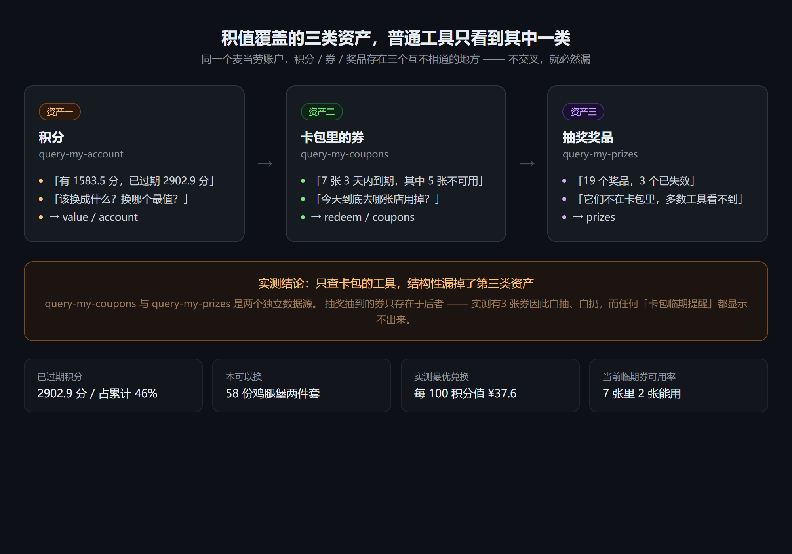
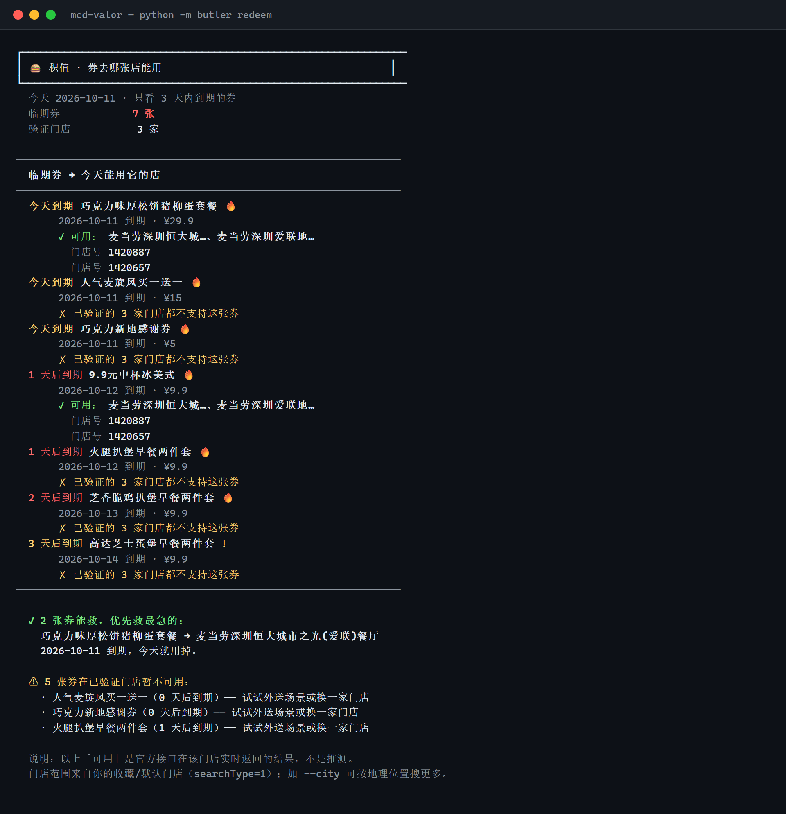
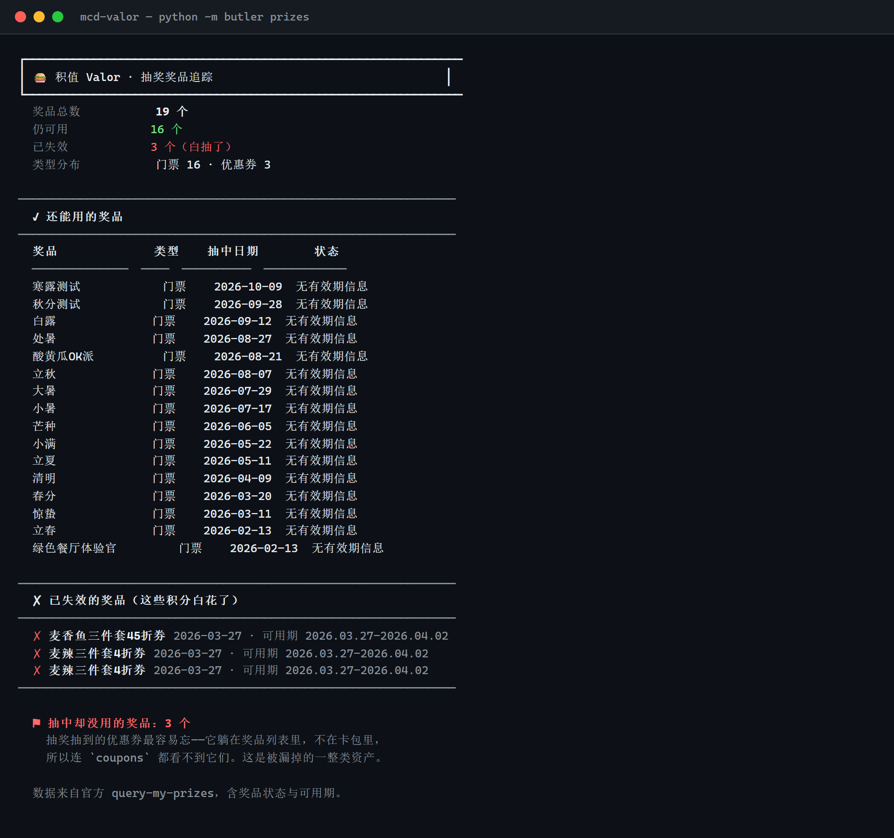

<div align="center">

# 💎 积值 Valor · 过期资产抢救队

**市面上的工具都在帮你「攒」。积值只关心一件事：你手里这些会过期的东西，到底该怎么用掉、用在哪、还能不能救回来。**

三个实测发现，多数人不知道（**2026-10-11 实测**）：

| 发现 | 数据 |
| --- | --- |
| 你的积分已经在悄悄蒸发 | 累计 6345.4 分里**2902.9 分已过期（46%）**，而 App 显示「本月过期 0 分」 |
| 大部分临期券其实用不了 | 3 天内到期的券里，**能用的不到一半** |
| 抽奖抽的券根本看不见 | 它们躺在**奖品列表**里不在卡包里——**19 个奖品中 3 个已失效**，只查卡包的工具结构上发现不了 |

> 券数每天在变（券会过期、也会新进账），所以这里写比例而非具体张数。
> 想看你自己那一刻的数字，跑一下 `python -m butler redeem` 就行。

<br>


**▶️ [在线演示页](https://lishoulan.github.io/mcd-valor/)** — 不想装也能先看效果

[](MCP_INTEGRATION.md)
[](SKILL.md)
[](requirements.txt)
[](requirements.txt)

**纯 Python 3.8+ 标准库 · 零第三方依赖 · 11 个 MCP Tool 全部真实调用 · 11 个命令 · 可作为 WorkBuddy Skill 安装**

*麦当劳程序员创意开发大赛参赛作品 · 非麦当劳官方产品*

> 💛 如果「过期资产该被抢救而不是被提醒」这个思路对你有用，点个 **⭐ Star** 支持一下。
> 本作品正在参加麦当劳程序员节创意开发大赛，**Star 数决定排名** 🙏

**👇 三分钟版**

| 你想 | 直接看 |
| --- | --- |
| **先看看效果** | **[▶️ 在线演示页](https://lishoulan.github.io/mcd-valor/)**（不用装，30 秒看完） |
| 先装起来试试 | [🚀 安装](#-安装两种方式任选其一)（2 分钟，只需一个免费 Token） |
| 只看核心结论 | [🎯 三个盲区](#-三个盲区我们和只做提醒的工具差在哪) |
| 看我们踩过的坑 | [🔬 我们怎么保证自己不说错](#-我们怎么保证自己不说错) |
| 全部命令 | [📋 全部命令](#-全部命令) |
| 挑细节 | [🔬 给爱看细节的同学](#-给爱看细节的同学) |
| 报 bug / 想知道怎么做的 | [❓ 小白常见问题](#-小白常见问题) |

</div>

---

## 🧭 30 秒看懂

**方式一 · 装成 WorkBuddy Skill**（推荐）

```bash
curl -fsSL https://raw.githubusercontent.com/Lishoulan/mcd-valor/HEAD/install.sh | bash
```

Windows PowerShell：

```powershell
irm https://raw.githubusercontent.com/Lishoulan/mcd-valor/HEAD/install.ps1 | iex
```

或者手动把 [`SKILL.md`](SKILL.md) 复制到 `~/.workbuddy/skills/mcd-valor/`。
装完**重开一轮会话**，然后直接说：「我的积分该换成什么」「我这几张券今天该去哪家店用」。

**方式二 · 命令行**（零依赖，clone 即跑）

```bash
git clone https://github.com/Lishoulan/mcd-valor.git && cd mcd-valor
export MCD_MCP_TOKEN=你的Token        # https://open.mcd.cn/mcp 申请
python -m butler redeem
```

```text
$ python -m butler value

┌────────────────────────────────────────────────────────────────
│ 🍔 积值 Valor · 你的积分该怎么花                              │
└────────────────────────────────────────────────────────────────
  可用积分           1583.5 分
  已过期            2902.9 分（占累计 46%）

  兑换商城：50 件在架商品

  已剔除 13 件已下架商品（经 mall-product-detail 逐个核实，返回 610403）
────────────────────────────────────────────────────────────────
  ★ 兑换性价比排行 · 每 100 积分能换多少元
────────────────────────────────────────────────────────────────
  商品                           需积分     面值    每100分  你现在
  ──────────────────────  ──────  ─────  ───────  ──────────
  6.9元可乐麦炫酷                   50   ¥6.9    ¥13.8  可换 31 份
  6.9元香芋派/菠萝派任选               50   ¥6.9    ¥13.8  可换 31 份
  10.9元指定小食任选                100  ¥10.9    ¥10.9  可换 15 份
  10.9元指定小食任选                200  ¥10.9     ¥5.5  可换 7 份
  17.9元板烧可乐组合                500  ¥17.9     ¥3.6  可换 3 份
  16.9元麦辣可乐组合                500  ¥16.9     ¥3.4  可换 3 份
  21.9元巨无霸可乐组合                800  ¥21.9     ¥2.7  可换 1 份

  ✓ 最划算：6.9元可乐麦炫酷
    50 积分换 ¥6.9，每 100 积分值 ¥13.8；你的积分够换 31 份。

────────────────────────────────────────────────────────────────
  🎰 另一条路：积分抽奖
────────────────────────────────────────────────────────────────
  活动             周六麦金喜抽奖（进行中）
  单次消耗           24 积分
  你的积分可抽         65 次
  奖品池            10 种

  · 官方未公开各奖品的中奖概率，所以本工具不计算抽奖期望值——
    只如实告诉你成本与奖池。换不换由你决定。

────────────────────────────────────────────────────────────────
  ⚑ 你已经白白过期的 2902.9 分，本可以换 58 份「18.8元麦辣鸡腿汉…」
    积分是会蒸发的。这一次，别让它再躺着过期。
────────────────────────────────────────────────────────────────
```

**真实最划算的兑换是 50 积分换 ¥6.9 的可乐麦炫酷 —— 每 100 积分值 ¥13.8。**

而更值得注意的是：**排行榜第一名曾经是「50 积分换 ¥18.8 的鸡腿堡两件套」，每 100 分值 ¥37.6。
但它早已下架** —— 麦当劳 API 会把下架商品一起返回，`status` 恒为 2 区分不出来。

本工具**逐个调 `mall-product-detail` 核验**，把 13 件已下架的商品剔出推荐
（实测 50 件里 19 件下架，性价比前 12 名中**8 个**已下架，含原前 3 名）。

所以你看到的推荐**是真能兑换的**，而不是一商城看起来划算、下单才发现没了的东西。

这也意味着：**你的积分实际贬值比想象的更快** —— 真正在架的最优汇率只有 ¥13.8/100 分，
不是 ¥37.6。

积分不是「攒着换个大件」的资产，而是**每天都在贬值的消耗品**。
你账户里 45.8% 的积分已经蒸发了，根子在于：**没人告诉你该换什么**。

`value` 回答三件事：

1. **我能换什么** —— 拉全量兑换商城，**并逐个核验是否还在架**
2. **换哪个最值** —— 按「每 100 积分值多少元」排序，只推在架的
3. **是换还是抽奖** —— 如实列出成本与奖池，**明确拒绝计算期望值**（官方没公布中奖概率）

### 另一条主线：`redeem` ——券该去哪家店用掉

```text
$ python -m butler redeem
  今天 2026-10-11 · 只看 3 天内到期的券
  临期券            6 张
  验证门店           3 家

  今天到期 巧克力味厚松饼猪柳蛋套餐 🔥
       ✓ 可用： 麦当劳深圳恒大城…、麦当劳深圳爱联地…
         门店号 1420887
         门店号 1420657
  今天到期 人气麦旋风买一送一 🔥
       ✗ 到店场景：这 3 家门店都不支持这张券
  今天到期 巧克力新地感谢券 🔥
       ✓ 可用： 麦当劳深圳恒大城…

  ✗ 4 张券确认救不回
```

**「有 6 张券要过期」是噪音；「其中 4 张真的用不了了，别白跑」才是价值。**

### 它不只说「不可用」，还会追问一句然后再回答

旧版对不可用的券建议「试试外送场景或换一家门店」——
**但它从来没查过外送**。这属于「建议一个没验证过的出路」，比不给建议更糟。

现在它会**真的去查外送券池**（需要 `beCode`，且这字段只在得来速门店里有，
收藏门店不返回——都是实测踩出来的），然后给你两种真结论之一：

```
  外送场景核对中…
  ✗ 外送也不可用： 人气麦旋风买一送一
  ✗ 外送也不可用： 火腿扒堡早餐两件套

  ✗ 4 张券确认救不回：
    · 人气麦旋风买一送一（2026-10-11 到期）
    · 火腿扒堡早餐两件套（2026-10-12 到期）
      到店 3 家门店不支持，外送也不在券池——这张券这次用不了了。
```

**它也认怂**：取不到 `beCode` 时会老实标「外送未核验」，不假装查过。

### 📈 它不是贴一张图，而是每天在跑

券每天在过期、每天有新的进账——**别的项目都只贴某一刻的截图，
你没法判断那是真的还是编的**。所以我们把每天的真实结果记下来：

| 日期 | 可用积分 | 已过期 | 券总数 | 3天内到期 | **能用掉的** | 奖品(失效) |
|---|---:|---:|---:|---:|---:|---:|
| 2026-10-11 | 1583.5 | 2902.9 | 15 | 6 | **2** | 19 (3) |

> 「能用掉的」不是卡包张数，而是**逐张券 × 逐家门店交叉验证后真正能被用掉的张数**。
> 通常它明显小于「3 天内到期」——**差值就是注定归零的资产**。

记录由 `tools/record_run.py` 生成（原始数据 `examples/run-log.jsonl`），
详见 [docs/RUN_LOG.md](docs/RUN_LOG.md)。
**这是别人抄不走的东西**——一张截图可以被复制，一条时间序列只能被跑出来。

<details>
<summary><b>怎么补一条记录（点击展开）</b></summary>

**这不是必须的，也不需要每天跑。** 工具本身在需要的时候敲一条命令即可，
不需要后台常驻。

```bash
export MCD_MCP_TOKEN=你的Token
python tools/record_run.py      # 约 1 分钟，抓一次真实数据

git add examples/run-log.jsonl docs/RUN_LOG.md
git commit -m "chore: 跨天记录 $(date +%F)" && git push
```

想攒证据就隔几天跑一次，跑三五天已经足够说明问题。

> **为什么没有用 GitHub Actions 自动跑？**
> 实测 GitHub 的美国 runner 访问 `mcp.mcd.cn` 返回 **HTTP 401**（同一个 Token 在本机是 200），
> 原因未公开。**你的 Token 也不该从境外机器发出去** —— 所以改成本机定时跑。


---

## 🎯 三个盲区（我们和只做提醒的工具差在哪）

### 盲区一：券的「门店可用性」几乎没人查

麦当劳 MCP 有 `query-store-coupons` 能查「你在某门店实际能用哪些券」，
但 103 个参赛项目里**几乎没有把它和卡包券交叉起来用的**。

结果是：所有人都能告诉你「你有几张券要过期」，但没人告诉你**「所以今天该去哪家店」**。

`redeem` 把 `query-my-coupons` × `query-nearby-stores` × `query-store-coupons`
三个 Tool 交叉，回答的正是最后那一问。而且它严格区分三态：

| 状态 | 含义 |
| --- | --- |
| `✓ 可用` | 该店接口明确返回这张券，附门店编号 |
| `✗ 不支持` | 已验证的门店都明确返回了空 |
| `? 未验证` | 没查到，不谎报 |

### 盲区二：抽奖奖品不在卡包里

`query-my-coupons`（卡包券）和 `query-my-prizes`（抽奖奖品）
是**两个完全独立的数据源**。抽奖抽到的券**只在后者里**。

所以任何只查卡包的临期提醒工具——**结构上就看不到它们**。
实测该账户 19 个奖品里 3 个已失效，全是抽中的优惠券，
可用期只有 6 天却没人用掉。

`prizes` 专门管这一段。**积分 → 抽奖 → 奖品 → 奖品失效**，全生命周期覆盖。

### 盲区三：积分是消耗品，不是资产

因为「攒着」是个陷阱：

| 常见做法 | 为什么失败 |
| --- | --- |
| 攒到某个「大奖品」 | 兑换目录里**没有大额奖品**，且看起来划算的往往已下架 |
| 等有活动再说 | 活动不定期，等到就忘了 |
| 到期提醒了才行动 | 看到数字才发现已经晚了——**过期不可逆** |

解法是**把决策变成一次性算清**：`value` 把 50 件商品全拉出来，
逐个核验是否还在架，再告诉你真正能换的最优解是什么。

**把积分当天花掉，不是败家，是止损。**

而券的逻辑是反过来的：券是**先临期、再决定去哪用**，
所以另有一条 `redeem` 命令专治「一堆券里大半今天根本用不了」。

还有第三类资产最容易被忽略：**抽奖抽到的奖品**。
它们躺在**奖品列表**里，不在**卡包**里——只查卡包的工具根本看不到。
`prizes` 命令专门管这一类，实测发现 3 张抽奖券就这么白抽白扔了。



**三类资产，三个断点，全生命周期覆盖：**

```
积分  ──account / value──▶  在贬值，该换成什么（性价比排行 + 抽奖决策）
券    ──redeem / coupons──▶  临期的去哪家店才用得掉（交叉验证）
奖品  ──prizes──────────▶  抽到的别躺在列表里过期（卡包看不到）
```

---

## 🔬 我们怎么保证自己不说错

这一节讲**我们检查过、并且真的改掉的东西**——
包括让我们自己下架了宣传数字的那些。

### 一次自检，改掉了两个「说了等于没说」的结论

我们用一个问题逐条审视 11 个命令：**「如果没人投票、没人评分，你还会用它吗？」**

两个命令当时没过这关：

| 命令 | 当时的问题 | 现在 |
| --- | --- | --- |
| `value` | 榜首「50 积分换 ¥18.8」调接口返回 `610403 商品已下架` —— **它在推荐换不了的东西** | 逐个调 `mall-product-detail` 核验，剔除后如实告知剔了几件 |
| `redeem` | 对不可用的券建议「试试外送场景」—— **但它从来没查过外送** | 真去查外送券池；查不到就标「未核验」，不假装 |

第二个更糟的地方在于：我们实测查了 6 家门店（收藏店 3 家 + 按位置搜 3 家），
结果那些券**在任何一家的券池里都不存在**。
**「换一家门店」这个建议本身就是误导** —— 用户到了门口才发现用不了。

> 注：券数每天在变（`examples/redeem.txt` 是 2026-10-11 的快照），
> 所以这里只讲**方法**，不写具体几张。

### 因此，README 里最大的那个数字被改掉了

`value` 原来的结论是「每 100 积分值 **¥37.6**」。
剔除下架商品后（2026-10-11 实测剔除 13 件），真实值是 **¥13.8**：

| | 每 100 积分值 | 说明 |
| --- | --- | --- |
| 旧 | ¥37.6 | 榜首是已下架商品，性价比前 12 名中 8 个已下架，虚高 |
| **新** | **¥13.8** | 逐个核验后剩下的真实最优 |

**降了 63%。** 我们选择改掉它，而不是保留一个更好看的数字 ——
因为用户是照着这个数字去兑换的。

> 商城商品会随时间上下架，这个比例是 2026-10-11 的实测值。
> 但**无论数字怎么变，「推荐前先核验」这件事不会变**。

### 三处「我们宁可说不知道」

**① 官方字段自己就不自洽，我们如实披露**

```
account 输出里：「本月将过期 0 分」 + 「已过期 2902.9 分」

查原始字段：
  累计 6345.4 − 可用 1583.5 − 已用 1595.0 = 3166.9
  但 expiredPoint = 2902.9      ← 差 264 分，官方没解释
```

工具现在会说明 `expiredPoint` 是**累计口径**而非「本月过期」，
并把这个差额摆出来，**不替官方猜它是什么**。

**② 不计算抽奖期望值**

`query-lottery-info` 的 `prizes[]` 里**没有任何中奖概率字段**。
概率未知时算期望值就是编造 —— 所以只给成本与奖池，换不换由你决定。

**③ 没查过的场景标「未核验」，不说「不可用」**

`redeem` 区分三态：`✓可用` / `✗不支持` / `?未核验`。
取不到 `beCode` 时它会老实认怂，而不是默认判死。

### 这类 bug 单元测试测不出来

上面两个问题，**函数返回值完全正常、当时手写的回归全绿**。
它们需要真实接口 + 「这个结论对不对」的判断力。

所以这个项目真正的检验方式是：
**拿真实数据跑一遍，然后质疑每一个结论。**

也正因如此，我们后来把「质疑」本身做成了 4 个可复跑的测试
（合计 58 个断言点：18 条文档命令 + 16 条链接 + 8 个空账户 + 16 条 Windows）——
见下面三节。

### 我们测过、但别人通常不测的：空账户

我的账户有积分、有券、有门店—— **所以「什么都没有」这条路我一开始也从没走过**。
而新用户装上工具的第一天就是空账户。

`tools/test_empty_account.py` 把所有接口替换成空返回，黑盒验证 8 个命令：

```bash
export MCD_MCP_TOKEN=你的Token   # 只用于通过 MCP 握手，业务调用全被拦截
python tools/test_empty_account.py
```

```text
✓ 8 个命令在全新空账户下均优雅降级，无未捕获异常
```

实际输出都是**带出路的**，不是干巴巴一句「无数据」：

| 命令 | 空账户下的输出 |
| --- | --- |
| `coupons` | 「你的卡包是空的 —— 一张券都没有」**+ 告诉你去 `claim` 领券** |
| `expiring` | 「3 天内什么都不用过期 —— 钱包很健康」 |
| `prizes` | 「你还没有抽奖记录」**+ 告诉你 `value` 能看抽奖成本** |
| `value` | 「兑换商城 0 件在架」**+ 说明本工具不代下单** |

另外还实测过四种失败场景，都不会抛裸异常：

| 场景 | 输出 |
| --- | --- |
| 没设 `MCD_MCP_TOKEN` | 给出三种系统各自的设置命令 + 申请地址 |
| Token 写错 | 「该Token 不存在或已失效」 |
| 网络不通 / 502 | 「请检查网络或代理设置」+ 三条排查建议 |

### 文档里的命令，逐条实跑过

文档写的命令如果跑不通，那文档就是 bug。所以直接把它变成测试：

```bash
export MCD_MCP_TOKEN=你的Token
python tools/test_doc_commands.py
```

它会从 9 个文档里抽出所有 `python -m butler ...` 示例并**逐条真的执行**：

```text
文档里出现的命令共 18 条
✓ butler account  ✓ butler redeem  ✓ butler value
✓ butler stores 地铁站 --dt --city 深圳   ...
通过 18 条，失败 0 条
```

**这个测试当场抓出过一个真 bug**：`stores` 的 `--dt`（搜得来速）必须配 `--city`，
而文档里最初漏了，照着抄会报 `600050 收藏餐厅列表为空`——
错误信息还会把人引向「接口有问题」，想不到是自己少写了参数。已修正。

### Windows 路径也实跑过

其他测试都在 Git Bash / subprocess 里跑，**Windows 用户路径是另一回事**：

```powershell
$env:MCD_MCP_TOKEN = "你的Token"
python tools\test_windows.ps1
```

```text
=== PowerShell 5.1.26100.9444 ===
  OK   butler account          OK   butler nutrition 麦满分
  OK   butler stores 北大 --city 北京
  OK   butler stores 地铁站 --dt --city 深圳   ...
通过 16 / 16
OK Windows 路径全部可用
```

**16 条全部通过，含中文门店名参数** —— 在 PowerShell 5.1 + Python 3.13 上实测。

### 其他工具通常不会告诉你的事

| 现象 | 真相 |
| --- | --- |
| 券 × 门店查不到 | 门店**不存在或不支持时返回空数组而非报错** —— 空数组是合法的「不可用」信号 |
| `searchType=1` 搜不到别的店 | 它会**忽略 `keyword`**（只搜收藏店），需 `searchType=2` + 城市 |
| 外送场景报错 600048 | `beType=2/5/6` 时**必传 `beCode`** |
| `status` 恒为 2 | 商城的 `status` **区分不出下架**，只有 `mall-product-detail` 能判 |
| 字段名是 `currentMouthExpirePoint` | 服务端把 `Month` 拼成了 `Mouth`，按直觉写会取到空值 |
| `--endpoint` 放子命令后会报错 | argparse 全局参数的通病，本工具**两个位置都支持** |

细节见 [`MCP_INTEGRATION.md`](MCP_INTEGRATION.md)。

---

## 🚀 安装（两种方式，任选其一）

> 两条路都只需要一个东西：**MCP Token**（免费，1 分钟申请）。
> 不需要 build、不需要装任何第三方包、不需要配置文件。

### 🥇 方式一：装成 WorkBuddy Skill（推荐，最省事）

**Linux / macOS / Git Bash**

```bash
curl -fsSL https://raw.githubusercontent.com/Lishoulan/mcd-valor/HEAD/install.sh | bash
```

**Windows PowerShell**

```powershell
irm https://raw.githubusercontent.com/Lishoulan/mcd-valor/HEAD/install.ps1 | iex
```

装完**重开一轮 WorkBuddy 会话**，然后直接说人话就行：

- 「我的积分该换成什么」
- 「我这几张券今天该去哪家店用」
- 「抽奖抽的券还有哪些能用」
- 「帮我做个账户过期资产体检」

<details>
<summary>不想用一键脚本？</summary>

手动把 [`SKILL.md`](SKILL.md) 复制到 `~/.workbuddy/skills/mcd-valor/` 即可。
首次使用仍需在 WorkBuddy 里启用麦当劳 MCP 连接器 `mcd-mcp` 并填入 Token。
</details>

### 🥈 方式二：命令行

```bash
# 1. 拿代码（零依赖，不用 pip install 任何东西）
git clone https://github.com/Lishoulan/mcd-valor.git && cd mcd-valor

# 2. 申请 Token：https://open.mcd.cn/mcp → 登录 → 控制台 → 激活 → 一键复制

# 3. 配好 Token
export MCD_MCP_TOKEN=你的Token        # Linux / macOS / Git Bash
# set MCD_MCP_TOKEN=你的Token         # Windows CMD
# $env:MCD_MCP_TOKEN='你的Token'      # PowerShell

# 4. 跑起来
python -m butler redeem
```

Windows 嫌配环境变量麻烦，可以直接用 PowerShell：

```powershell
$env:MCD_MCP_TOKEN = "你的Token"
python -m butler redeem
```

**Windows 上最常见的两个坑**（都是实测撞到的）：

| 现象 | 原因与解法 |
| --- | --- |
| `无法将"python"项识别为 cmdlet` | Python 没加进 PATH。装 Python 时勾选 **Add python.exe to PATH**；或在 Microsoft Store 搜「Python」装（自动配好 PATH）。 |
| PowerShell 5.1 里中文变乱码（`鈹?` `绉€`） | **只是捕获输出时的问题**，直接看终端显示是正常的。想彻底避免就把 PowerShell 升级到 7+，或在命令前加 `$OutputEncoding = [Console]::OutputEncoding = [Text.Encoding]::UTF8`。 |

> 产品本身在 Windows 上验证过：11 个命令在 PowerShell 5.1 + Python 3.13 全部实跑通过。

没配 Token 时它会自己告诉你怎么办：
> ```text
> ✗ 鉴权问题
>   没有检测到环境变量 MCD_MCP_TOKEN。
>     · Linux / macOS :  export MCD_MCP_TOKEN=你的Token
>     · Token 申请地址:  https://open.mcd.cn/mcp
> ```

---

## 🎬 演示效果（真实运行输出）

> 以下全部是**真实调用麦当劳 MCP** 的输出。为方便粘贴已去掉 ANSI 颜色码，
> 终端里实际是彩色显示的。

### ★★★ `python -m butler value` —— 积分该换成什么（招牌）

完整真实输出见上方「30 秒看懂」。这里补充它**刻意克制的三处**——
都是为了不骗人：

- **不含明标价的商品不参与性价比计算** —— 派对类按场次核价，不能按商品名猜面值
- **不计算抽奖期望值** —— 官方未公布中奖概率，算了就是编数据
- **不代下单** —— 本项目不接入 `mall-create-order`，只做决策支持

### ★★ `python -m butler redeem` —— 临期券今天去哪张店能用



```text
  今天 2026-10-11 · 只看 3 天内到期的券
  临期券            7 张
  验证门店           3 家

────────────────────────────────────────────────────────────────
  临期券 → 今天能用它的店
────────────────────────────────────────────────────────────────
  今天到期 巧克力味厚松饼猪柳蛋套餐 🔥
       2026-10-11 到期 · ¥29.9
       ✓ 可用： 麦当劳深圳恒大城…、麦当劳深圳爱联地…
         门店号 1420887
         门店号 1420657
  今天到期 人气麦旋风买一送一 🔥
       2026-10-11 到期 · ¥15
       ✗ 已验证的 3 家门店都不支持这张券
  今天到期 巧克力新地感谢券 🔥
       2026-10-11 到期 · ¥5
       ✗ 已验证的 3 家门店都不支持这张券
  1 天后到期 9.9元中杯冰美式 🔥
       2026-10-12 到期 · ¥9.9
       ✓ 可用： 麦当劳深圳恒大城…、麦当劳深圳爱联地…
         门店号 1420887
         门店号 1420657
  1 天后到期 火腿扒堡早餐两件套 🔥
       2026-10-12 到期 · ¥9.9
       ✗ 到店场景：这 3 家门店都不支持这张券
  ...

────────────────────────────────────────────────────────────────

  外送场景核对中…
  ✗ 外送也不可用： 人气麦旋风买一送一
  ✗ 外送也不可用： 火腿扒堡早餐两件套
────────────────────────────────────────────────────────────────

  ✓ 2 张券能救，优先救最急的：
    巧克力味厚松饼猪柳蛋套餐 → 麦当劳深圳恒大城市之光(爱联)餐厅
    2026-10-11 到期，今天就用掉。

  ✗ 4 张券确认救不回：
    · 人气麦旋风买一送一（2026-10-11 到期）
    · 火腿扒堡早餐两件套（2026-10-12 到期）
      到店 3 家门店不支持，外送也不在券池——这张券这次用不了了。
```

> **今天到期的券里，大部分连外卖都救不回来——别白跑一趟。**
> 一个只做提醒的工具，会让你为这些券挨个跑店，最后发现一张都用不上。
>
> 注意这个比例**每天都不同** —— 券在过期、门店的券池在变。
> 所以本工具不承诺「提醒」，只如实回答**此刻**哪张券能用。

### ★★ `python -m butler prizes` —— 被漏掉的那一整类资产



```text
  奖品总数           19 个
  仍可用            16 个
  已失效            3 个（白抽了）
  类型分布           门票 16 · 优惠券 3

────────────────────────────────────────────────────────────────
  ✗ 已失效的奖品（这些积分白花了）
────────────────────────────────────────────────────────────────
  ✗ 麦香鱼三件套45折券 2026-03-27 · 可用期 2026.03.27-2026.04.02
  ✗ 麦辣三件套4折券 2026-03-27 · 可用期 2026.03.27-2026.04.02
  ✗ 麦辣三件套4折券 2026-03-27 · 可用期 2026.03.27-2026.04.02

  ⚑ 抽中却没用的奖品：3 个
    抽奖抽到的优惠券最容易忘——它躺在奖品列表里，不在卡包里，
    所以连 `coupons` 都看不到它们。这是被漏掉的一整类资产。
```

> **这是本项目发现的第三个盲区。** 抽奖抽到的券存在**奖品列表**里，
> 不在**卡包**里 —— 所以任何只查卡包的工具（包括大部分「临期提醒」）
> **根本看不到它们**。实测有 3 张券就是这么白抽、白扔的。

### ★ `python -m butler account` —— 那个刺眼的数字

```text
  可用积分           1583.5 分
  累计积分           6345.4 分
  已使用积分          1595 分

  本月将过期          0 分（本月无积分过期）
  下月将过期          0 分
  上月已过期          0 分

  ⚠  你已经白白过期了 2902.9 分
  这些积分本来可以换的。下一张券包别再让它躺着过期了。
```

> 这不是设计好的文案。**累计 6345.4 分里已有 45.8% 过期掉了**，
> 而账户显示「本月过期 0 分」—— 也就是说当下完全没有紧迫感，
> 历史上已经亏掉近一半。`account` 就是要把这个数字天天摆在最显眼的位置。

### `python -m butler spend` —— 消费报告

```text
  订单总数           10 单
  总花费            ¥229.7
  实付订单           6 单（4 单为 0 元：积分兑换/赠券）
  客单价（全部）        ¥23.0
  客单价（实付）        ¥38.3

  ♥ 最爱门店 TOP3
  ██████████ 麦当劳深圳尚云花园餐厅2 次
  ██████████ 麦当劳汕头大学路得来速餐厅                  2 次
  ██████████ 麦当劳深圳宝龙餐厅                      2 次

  ★ 点得最多的餐品 TOP5
  ██████████ 中薯条                            10 份
  ███████ 板烧鸡腿堡                          7 份
  ███████ 无糖可口可乐中杯                       7 份
  ██████ 可乐中杯                           6 份
  █████ 麦乐鸡4块                          5 份

  麦麦侧写
  · 你最常去：麦当劳深圳尚云花园餐厅（2/10 单，占 20%）
  · 你最常点：中薯条（10 份）
  · 客单价 ¥38.3，中度麦迷
```

> 餐品统计**展开套餐子项**（`comboItemList`），所以榜首是「中薯条 10 份」
> 而不是那个叫「人气超值四件套随心选」的套餐 —— 后者会掩盖真正的消费习惯。

### 其余命令

`expiring`（积分与券合并的过期倒计时）、`coupons`（券包全景三色上色）、
`claim`（一键领券）、`stores`（附近门店）、`calendar`（活动日历）、
`nutrition 麦满分`（热量三色分级）的输出，直接跑命令即可复现。

---

## 📋 全部命令

| 命令 | 作用 | 用到的 MCP Tool |
| --- | --- | --- |
| **`value`** | **★★★ 积分该换成什么：性价比排行 + 抽奖决策** | `query-my-account` + `mall-points-products` + `query-lottery-info` |
| **`prizes`** | **★★ 抽奖奖品追踪：抽到的券别躺在奖品列表里过期** | `query-my-prizes` |
| **`redeem`** | **★★ 临期券 × 门店可用性闭环** | `query-my-coupons` + `query-nearby-stores` + `query-store-coupons` |
| `expiring` | 积分与券合并的过期倒计时清单 | `query-my-account` + `query-my-coupons` |
| `account` | 积分账户总览 + 历史过期损失 | `query-my-account` |
| `coupons` | 券包全景，按临期度三色上色 | `query-my-coupons`（翻页） |
| `claim` | 一键领券 + 卡包前后对比 | `auto-bind-coupons` |
| `stores` | 附近门店搜索 | `query-nearby-stores` |
| `nutrition` | 160 条餐品营养数据过滤与分级 | `list-nutrition-foods` |
| `calendar` | 本月活动日历 | `campaign-calendar` |
| `spend` | 消费报告 | `order-list` |

### 常用参数

```bash
python -m butler redeem --window 7         # 提醒窗口改成 7 天
python -m butler redeem 爱联 --limit 2      # 只验证 2 家门店（省请求）
python -m butler expiring --window 14        # 两周内的临期全景
python -m butler nutrition 鸡腿堡            # 关键词过滤营养表
python -m butler stores 北大 --city 北京      # 按地理位置搜（searchType=2）
python -m butler stores 地铁站 --dt --city 深圳 # 只搜得来速车道取餐（--dt 必须配 --city）
python -m butler calendar --date 2026-10-15  # 指定日期前后三天的活动
```

> `--limit` 存在的原因：官方限流是**每 Token 每分钟 600 次请求**，
> `redeem` 逐店验证会成倍放大请求数 —— 门店多时用它控制一下。

---

## 🧑‍🤝‍🧑 谁需要它（目标用户）

| 你是 | 你的痛点 | 你会问 |
| --- | --- | --- |
| **积分糊涂虫** | 攒着攒着就过期了，从没算过划算不划算 | 「我这些积分到底该换什么？换哪个最值？」 |
| **临期焦虑者** | 知道有券要过期，但不知道能去哪用 | 「我这几张券今天哪家店能用？」 |
| **决策困难户** | 50 件兑换商品摆在面前，看不懂差别 | 「这几件哪个性价比高？我能换几份？」 |
| **积分惜福派** | 积分到期才想起来，历史上已白扔近半 | 「我的积分还剩多少会过期？」 |
| **健身控卡人** | 不知道麦当劳哪个选择热量低 | 「麦满分这几个版本热量差多少？」 |

**共同点**：他们都不是「不会用麦当劳 App」，
而是**卡在「知道该处理了，但不知道具体该怎么办」这一步**。
积值只解决这一步。

---

## 🔬 给爱看细节的同学

### 五个实测发现（非文档推测）

对接过程中，通过真实调用发现了 5 个光读文档发现不了的问题：

**1. 端点是根路径，不是 `/mcp`**

按 MCP 惯例猜成 `https://mcp.mcd.cn/mcp` 会得到 `404 Route Not Found`。
`/sse`、`/message` 同样 404 —— 服务端只提供 Streamable-HTTP。

**2. 返回格式有 5 种形态，同一 Server 内不统一**

| 形态 | 工具 | 表现 |
| --- | --- | --- |
| A | `query-my-account`、`order-list` | `## Original Response` 后是完整 JSON |
| B | `query-nearby-stores` | 字段说明 + **换行缩进**的裸 JSON，无 marker |
| C | `query-my-coupons`、`campaign-calendar` | **纯 Markdown**，没有 JSON |
| D | `list-nutrition-foods` | JSON的 `data` 是个 CSV 字符串 |
| E | `auto-bind-coupons` | 纯 Markdown 的成功/失败文案 |

`client.extract_json` 因此做了三级兜底：`## Original Response` 后半段 →
整段当 JSON → **全文 `raw_decode` 扫描取覆盖最长的合法 JSON 值**。
最后一步专为形态 B 而设，逐行匹配会漏掉缩进的情况。

**3. `query-nearby-stores` 在 `searchType=1` 下忽略 `keyword`**

搜「爱联」和搜「不存在的xyz」返回的是**完全相同的 3 家店**。
所以 `stores` 与 `redeem` 都在本地按店名 + 地址二次过滤，
并明确告知「搜到 N 家但都不含关键词」—— 而不是假装关键词生效了。
要让服务端真正按地理搜，必须传 `--city`（`searchType=2`）。

**4. 券的有效期后面还拖着每日时段与星期限制**

```
- **有效期**: 2026-10-11 05:00-2026-10-11 10:29 周日 05:00-10:30
                    ^^^^^^^^^^^^^^^^^^^^^^^^^^^^ 到期日在这里，后面全是噪声
```

分隔符是半角 `-`，按 `-` 切必然碎。做法是只认 `yyyy-MM-dd`：
第一个是开始、第二个是结束，其余丢弃。

**5. 积分抽奖不公布中奖概率**

`query-lottery-info` 返回 10 种奖品，但**没有任何概率/权重字段**。
所以本项目**拒绝计算抽奖期望值** —— 那只能靠编。
只如实列出单次消耗（24 积分）、可抽次数、奖池清单，
然后把选择权交还给你。

### 两个容易踩的 Python 坑（都踩过）

**`re.findall` 带分组时返回元组列表，不是字符串列表**

```python
DATE_RE = re.compile(r"(\d{4})-(\d{2})-(\d{2})")
DATE_RE.findall("2026-10-06")            # → [('2026', '10', '06')]  ← 元组！
[DATE_RE.finditer("2026-10-06").__next__().group(0)]  # → ['2026-10-06']  ✅
```

症状极具迷惑性：所有券的到期日都变成 `None`，
`expiring` 报告「3 天内 0 张券过期」—— 看起来像业务结论，其实是代码 bug。

**表格对齐必须按显示宽度算，不能按字符数**

中文在终端占 2 列。`"%-20s" % "人气麦旋风买一送一"` 必然错位。
`ui._w()` 用 `unicodedata.east_asian_width` 逐字累加真实显示宽度，
截断也要按宽度（按字符截会砍出半行乱码）。

### 架构一句话

```
butler/
├── __main__.py      CLI 入口：argparse 路由 + 错误分流（401/429/网络分开报）
├── client.py        MCP Streamable-HTTP 客户端 + 5 种返回格式的多级兜底解析
├── commands.py      10 个子命令的业务实现
├── parsers.py       Markdown / CSV → 结构化数据（防御式解析，字段缺失不崩）
└── ui.py            ANSI 颜色 + 中文宽度感知表格
```

### 安全设计

| 面向 | 做法 |
| --- | --- |
| Token | 只从环境变量读，**代码/文档/配置里零硬编码** |
| 落盘 | 探测阶段的临时 `.env` 已主动删除，真实凭据不留在磁盘 |
| 外发 | 只向 `mcp.mcd.cn` 发请求，可用 `--endpoint` 覆盖 |
| 写操作 | 仅 `claim` 一个（调`auto-bind-coupons`），其余 9 个命令纯只读 |
| 下单 | **不接入任何下单 Tool**，只做决策支持 |
| 依赖 | 零第三方包，不存在供应链风险 |

---

## ❓ 小白常见问题

**Q：为什么榜首的「50 积分换 18.8 元」不见了？**

因为**它早已下架**。麦当劳的 `mall-points-products` 会把下架商品一起返回，
`status` 字段恒为 2 区分不出来，`downTime` 对派对类（未来日期）也不可靠。

实测 50 件商品里 19 件已下架，性价比前 12 名中 **8 个**已下架（含原前 3 名）。
本工具**逐个调 `mall-product-detail` 核验**（下架会返回 `610403`），把下架商品剔除。

所以真实的最优汇率是 **¥13.8 / 100 积分**，不是 ¥37.6 ——
**你的积分实际贬值比没有这个工具时想象的更快。**

**Q：它会不会偷偷帮我下单？**
不会。11 个命令里只有 `claim` 会写操作（领券）。
**本项目不接入 `mall-create-order`**，兑换全部由你在官方 App/小程序完成。

**Q：为什么不算抽奖期望值？**
因为官方 `query-lottery-info` **没有返回任何中奖概率字段**。
在概率未知的情况下计算期望值只能是编造。
所以只如实告诉你单次成本、可抽次数和奖池清单，判断权在你。

**Q：`redeem` 说「不支持这张券」，是不是它算错了？**
那是官方 `query-store-coupons` 对该门店的实时返回。
不同门店、不同场景（到店自取/得来速/外送）支持的券确实不同。
你可以加 `--city` 扩大门店范围，或换关键词验证别的店。

**Q：为什么门店只有 3 家？**
`searchType=1` 拿的是你的**收藏/默认门店**（该账户只有 3 家）。
想按地理位置搜更多门店，加 `--city 北京`。

**Q：Token 安全吗？**
相当于一把只开你自己家门的钥匙。本项目只把它放进内存里的请求头，
**不写文件、不打日志、不回显**。但它仍等同于你的账号凭证，
别贴到群里或 GitHub 上。

**Q：为什么终端里没颜色？**
输出到管道、`NO_COLOR` 环境变量或 `TERM=dumb` 时会自动降级为纯文本。
想强制开启设 `MCD_BUTLER_COLOR=1`，强制关闭设 `0`。

---

## 📁 项目结构

```
mcd-valor/
├── butler/                  源代码（零依赖）
├── SKILL.md                 WorkBuddy Skill 定义
├── install.sh / install.ps1 一键安装脚本（Skill 用户用）
├── examples/                10 个命令的真实运行输出（可复现核对）
├── README.md                本文件
├── MCP_INTEGRATION.md       MCP Server / Tool / 调用流程 / 业务价值
├── CONTEST_DECLARATION.md   参赛声明（官方原文）
├── workbuddy.md             WorkBuddy 开发上下文（专项奖励核验）
├── mcp-config.example.json  脱敏 MCP 配置示例
├── requirements.txt         零依赖声明
├── docs/
│   ├── RUN_LOG.md           跨天运行记录（可选，最硬的实证）
│   ├── images/              README 配图（真实输出渲染 + GIF 录屏）
│   └── RECORDING_DEMO.md    录制演示素材的指引
├── tools/                   辅助脚本（可选，非运行依赖）
│   ├── record_run.py        每日跑一次，追加跨天记录
│   ├── make_demo_gif.py     逐帧绘制终端文字 → GIF
│   ├── render_shot.js       终端输出 → PNG
│   └── render_html.js       HTML → PNG
├── LICENSE                  MIT
└── .gitignore
```

---

## 📄 参赛材料与声明

- [CONTEST_DECLARATION.md](CONTEST_DECLARATION.md) —— 参赛声明（官方原文，未做任何修改）
- [MCP_INTEGRATION.md](MCP_INTEGRATION.md) —— 使用的 MCP Tool、调用流程、字段映射与业务价值
- [workbuddy.md](workbuddy.md) —— WorkBuddy 专项奖励核验材料

本项目为麦当劳程序员创意开发大赛参赛作品，**由参赛者通过腾讯 WorkBuddy 智能体独立开发，
非麦当劳官方产品**。项目输出仅供参考，不构成医疗、营养或其他专业建议；
餐品信息、价格及供应状态以麦当劳官方渠道的实时结果为准。